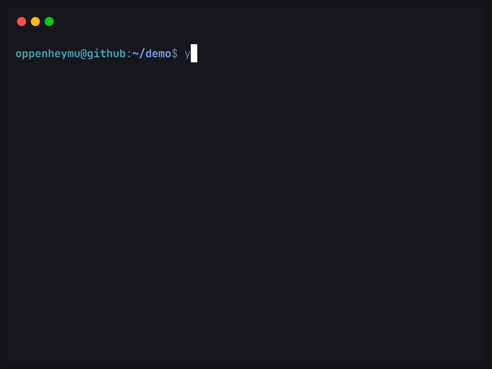
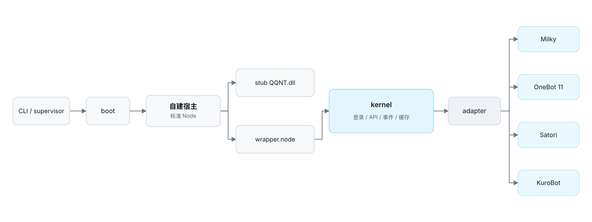

<div align="center">
<h1 id="napukettoqq">
  <picture>
    <source media="(prefers-color-scheme: dark)" srcset=".github/assets/wordmark-dark.svg">
    
  </picture>
</h1>
<p><b>基于 QQNT 原生模块的自托管机器人框架 —— 无客户端、无注入、原生直连</b></p>
<p>
  <a href="https://github.com/NapukettoDev/NapukettoQQ/actions/workflows/ci.yml"></a>
  <a href="https://www.npmjs.com/package/create-napukettoqq"></a>
  <a href="./LICENSE"></a>
</p>
</div>

## 支持的协议

| 协议 | 传输形态 | 能力概览 |
| :--- | :--- | :--- |
| **Milky** | 单端口 HTTP + SSE / WS + WebHook | 对齐 Milky 1.3.0；消息、群管、好友、群通知、群文件与表态 |
| **Satori** | HTTP RPC / WS 事件 | 消息、频道、群组、成员、好友与表态 |
| **OneBot11** | HTTP / WS / 反向 WS / Webhook | 消息、群管、好友、通知、系统与媒体 |
| **KuroBot** | 出站 WS 客户端 | QQ 群聊与 Minecraft 服务器互通 |

传输、鉴权、事件字段与限制见协议文档：[Milky](./docs/protocols/milky.md) ·
[Satori](./docs/protocols/satori.md) · [OneBot 11](./docs/protocols/onebot11.md) ·
[KuroBot](./docs/protocols/kurobot.md)。

## 快速开始

- **运行环境**：Node.js 24+（Windows 10/11 x64 或 Linux x64）。
- **依赖**：无需安装 QQ 客户端；Linux 另需 `libgnutls30` 与 X11 客户端库，见
  [运维手册的 Linux 部分](./docs/guides/operations.md#linux-原生宿主)。

### 创建并启动

```bash
pnpm create napukettoqq      # 按提示填写项目名
cd <项目名>
pnpm start
```

首次启动会在项目根目录生成 `napuketto.toml`。部署演示：


**Docker 部署（仅 `linux/amd64`）**：无需 Node.js 环境，使用官方镜像。

```bash
curl -fsSL https://raw.githubusercontent.com/NapukettoDev/NapukettoQQ/main/docker/compose.yaml -o compose.yaml
curl -fsSL https://raw.githubusercontent.com/NapukettoDev/NapukettoQQ/main/docker/napuketto.toml.example -o napuketto.toml
# 编辑 napuketto.toml 修改 qq 与 token（容器内监听地址保持 0.0.0.0）
docker compose up -d
docker compose logs -f      # 首次启动：下载官方包 → 解包 → 渲染二维码
```

完整说明见 [Docker 部署指南](./docs/guides/docker.md)。

### 配置

打开生成的 `napuketto.toml`：修改 `qq` 为机器人账号；设置 `token` 访问密钥（公网部署务必
配置）。模板注释含完整字段示例；进阶配置见 [配置文档](./docs/guides/configuration.md)。

## 结构

<p align="center">
  <picture>
    <source media="(prefers-color-scheme: dark)" srcset=".github/assets/architecture-dark.svg">
    
  </picture>
</p>

启动顺序与数据流见 [运行链路](./docs/architecture/runtime.md)；包拓扑与依赖方向见
[架构总览](./docs/architecture/overview.md)。

## 排障

```bash
pnpm exec napuketto status              # 查看 supervisor 与各账号状态
pnpm exec napuketto stop                # 停止全部服务
pnpm exec napuketto restart             # 重启 supervisor
```

日志位于 `<数据根>/<uin>/logs/`（`napuketto.log` 业务、`loader.log` 引导、
`napuketto-boot.log` 进程日志）。常见故障与缺库排障见
[运维手册](./docs/guides/operations.md)。

## 开发
所有改动经 PR 提交，合入前本地 `pnpm check` 必须通过；涉及发布内容的改动随提交附
changeset。规范见 [贡献指南](./.github/CONTRIBUTING.md) · [工程指南](./AGENTS.md) ·
[开发指南](./docs/guides/development.md)。

## 文档

| 类别 | 链接 |
| --- | --- |
| **总览** | [文档首页](./docs/README.md) · [架构总览](./docs/architecture/overview.md) · [运行链路](./docs/architecture/runtime.md) · [ADR](./docs/architecture/decisions.md) |
| **使用/开发** | [配置](./docs/guides/configuration.md) · [运维](./docs/guides/operations.md) · [Docker](./docs/guides/docker.md) · [开发](./docs/guides/development.md) |
| **协议** | [Milky](./docs/protocols/milky.md) · [OneBot 11](./docs/protocols/onebot11.md) · [Satori](./docs/protocols/satori.md) · [KuroBot](./docs/protocols/kurobot.md) |
| **生态/治理** | [Koishi 适配器](https://www.npmjs.com/package/koishi-plugin-adapter-napuketto) · [贡献](./.github/CONTRIBUTING.md) · [安全](./.github/SECURITY.md) · [MIT](./LICENSE) |

## English
**NapukettoQQ** is a self-hosted bot framework built on the QQ NT native module
(`wrapper.node`). It runs a standard Node.js process with a stub `QQNT.dll`, loads the native
module directly, and exposes **Milky**, **OneBot 11**, **Satori**, and **KuroBot** interfaces —
with no QQ client, no process injection, and no disk patching. Each account runs in its own
isolated host process supervised by the CLI, with all configuration in a single
`napuketto.toml` at the project root.

*Not affiliated with Tencent. Entirely original implementation with no third-party GPL code.
Released under the [MIT License](./LICENSE).*
