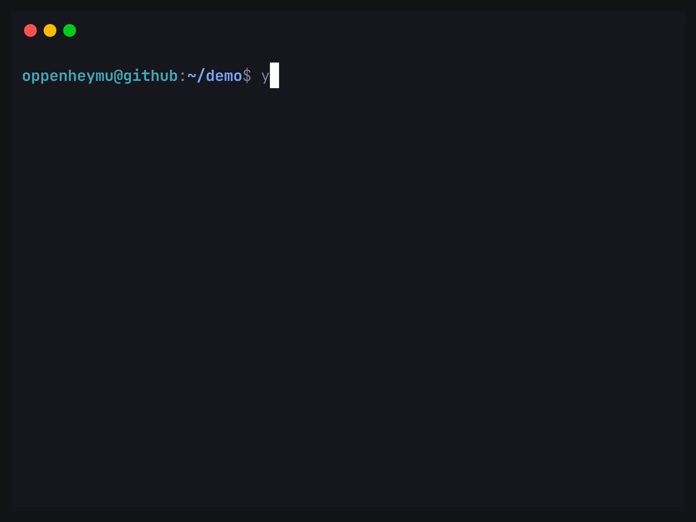
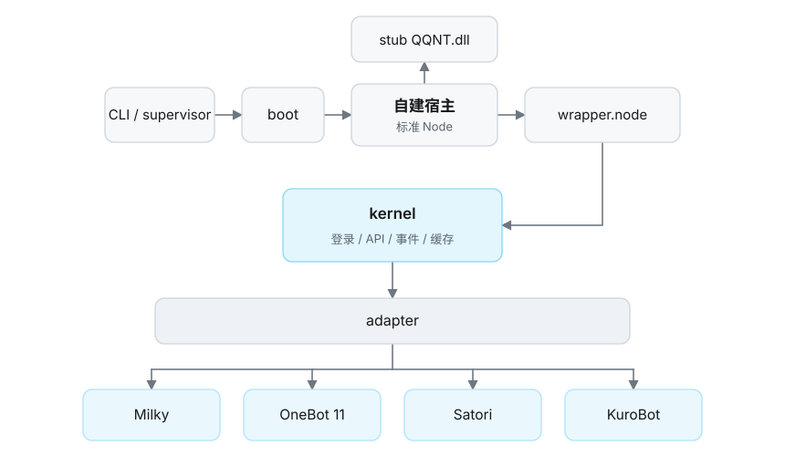

<div align="center">
<h1 id="napukettoqq">
  <picture>
    <source media="(prefers-color-scheme: dark)" srcset=".github/assets/wordmark-dark.svg">
    
  </picture>
</h1>
<p>
  <a href="https://github.com/NapukettoDev/NapukettoQQ/actions/workflows/ci.yml"></a>&emsp;
  <a href="https://www.npmjs.com/package/create-napukettoqq"></a>&emsp;
  <a href="./LICENSE"></a>
</p>
</div>

> [!WARNING]
> 　本项目基于 MIT 协议开源，开发初衷仅限于个人技术学习、协议研究与学术交流。
> 使用者在部署、修改或运行时必须严格遵守所在国家或地区的法律法规及《腾讯服务协议》、《QQ软件许可及服务协议》、《QQ号码规则》等平台服务条款。
> **严禁将本项目用于发送垃圾广告、恶意刷量、未授权数据抓取、网络攻击等任何违法违规或破坏平台正常运营秩序的行为**，由此产生的一切使用风险与法律责任均由使用者自行承担。

## 支持的协议

| 协议 | 传输形态 | 能力概览 |
| :--- | :--- | :--- |
| **Milky** | 单端口 HTTP + SSE / WS + WebHook | 消息、群管、好友、群通知、群文件与表态 |
| **Satori** | HTTP RPC / WS 事件 | 消息、频道、群组、成员、好友与表态 |
| **OneBot11** | HTTP / WS / 反向 WS / Webhook | 消息、群管、好友、通知、系统与媒体 |
| **KuroBot** | 出站 WS 客户端 | QQ 群聊与 Minecraft 服务器互通 |

协议文档（传输、鉴权、事件字段与限制）：[Milky](./docs/protocols/milky.md) ·
[Satori](./docs/protocols/satori.md) · [OneBot 11](./docs/protocols/onebot11.md) ·
[KuroBot](./docs/protocols/kurobot.md)

## 嵌入的框架

本项目为主流机器人框架提供了嵌入式的插件

如果你正在使用机器人框架，我们强烈建议你使用插件，而不是部署独立协议端：

| 框架 | 适配器仓库 |
| :--- | :--- |
| **Koishi** | [Adapter-Koishi](https://github.com/NapukettoDev/Adapter-Koishi) |

## 快速开始

- **运行环境**：Node.js 24+（Windows 10/11 x64 或 Linux x64）；无需安装 QQ 客户端。
- **依赖**：Linux 另需 `libgnutls30` 与 X11 客户端库，见[运维手册](./docs/guides/operations.md#linux-原生宿主)。

### 创建并启动

```bash
pnpm create napukettoqq      # 按提示填写项目名
cd <项目名>
pnpm start
```

首次启动会在项目根目录生成 `napuketto.toml`。部署演示：

<details>
<summary><b>点击查看部署演示</b></summary>


</details>

<details>
<summary><b>使用 Docker 部署（仅支持 <code>linux/amd64</code>）</b></summary>

官方容器镜像，无需 Node.js 环境：

```bash
curl -fsSL https://raw.githubusercontent.com/NapukettoDev/NapukettoQQ/main/docker/compose.yaml -o compose.yaml
curl -fsSL https://raw.githubusercontent.com/NapukettoDev/NapukettoQQ/main/docker/napuketto.toml.example -o napuketto.toml

# 编辑 napuketto.toml 修改 qq 与 token（容器内监听地址保持 0.0.0.0）
docker compose up -d
docker compose logs -f      # 首次启动：下载官方包 → 解包 → 渲染二维码
```

完整说明详见 [Docker 部署指南](./docs/guides/docker.md)。
</details>

<br>

### 配置

打开生成的 `napuketto.toml`：修改 `qq` 为机器人账号；设置 `token` 访问密钥（公网部署务必配置）\
模板注释含完整字段示例；进阶配置见 [配置文档](./docs/guides/configuration.md)。

## 结构

<p align="center">
  <picture>
    <source media="(prefers-color-scheme: dark)" srcset=".github/assets/architecture-dark.svg">
    
  </picture>
</p>

启动顺序与数据流见 [运行链路](./docs/architecture/runtime.md)；包拓扑与依赖方向见
[架构总览](./docs/architecture/overview.md)；文档导航见 [docs/README.md](./docs/README.md)，
架构决策记录见 [ADR](./docs/architecture/decisions.md)。

## 排障

```bash
pnpm exec napuketto status              # 查看 supervisor 与各账号状态
pnpm exec napuketto stop                # 停止全部服务
pnpm exec napuketto restart             # 重启 supervisor
```

日志位于 `<数据根>/<uin>/logs/`（`napuketto.log` 业务、`loader.log` 引导、`napuketto-boot.log`
进程日志）。常见故障与缺库排障见 [运维手册](./docs/guides/operations.md)。

## 开发

所有改动合入前本地 `pnpm check` 必须通过；涉及发布内容的改动随提交附changeset

规范见 [贡献指南](./.github/CONTRIBUTING.md) · [工程指南](./AGENTS.md) ·
[开发指南](./docs/guides/development.md) · [安全策略](./.github/SECURITY.md) ·
[Koishi适配器](https://www.npmjs.com/package/koishi-plugin-adapter-napuketto)

## 社区

> [!CAUTION]
> **本项目没有且不会有任何官方社区与交流群聊**，无任何 QQ 群、Telegram 群组或 Discord 频道

## 状态

<p align="center">
  
</p>

## English

**NapukettoQQ** is a self-hosted bot framework built on the QQ NT native module (`wrapper.node`).
It runs a standard Node.js process with a stub `QQNT.dll`, loads the native module directly, and
exposes **Milky**, **OneBot 11**, **Satori**, and **KuroBot** interfaces — no QQ client, no
injection, no disk patching; one account = one supervised host process, all config in one
`napuketto.toml`. *Not affiliated with Tencent; original implementation, no GPL code, [MIT](./LICENSE).*
