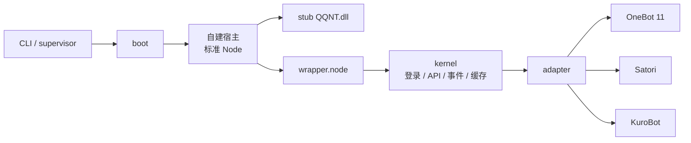

<div align="center">

<h1 id="napukettoqq">
  <picture>
    <source media="(prefers-color-scheme: dark)" srcset=".github/assets/wordmark-dark.svg">
    
  </picture>
</h1>

**基于 QQ NT 原生模块的自托管机器人框架 —— 无客户端、无注入、原生直连**

[](https://github.com/NapukettoDev/NapukettoQQ/actions/workflows/ci.yml)
&emsp;
[](https://www.npmjs.com/package/create-napukettoqq)
&emsp;
[](https://github.com/NapukettoDev/NapukettoQQ/releases)
&emsp;

&emsp;

&emsp;
[](./LICENSE)

<p>
  <a href="#核心特性">核心特性</a> •
  <a href="#支持的协议">协议</a> •
  <a href="#快速开始">快速开始</a> •
  <a href="#工作原理">工作原理</a> •
  <a href="#参与开发">参与开发</a> •
  <a href="./docs/README.md">文档</a> •
  <a href="#english">English</a>
</p>

</div>

---

## 核心特性

- **原生直连**：\
  自建宿主直接 `dlopen` `wrapper.node`，调用官方 NAPI 导出接口；不经过代理层，也不依赖外部协议端。

- **无侵入运行**：\
  不拉起 QQ 客户端、不注入 QQ 进程、不修改安装目录；运行期只在内存中操作，升级/卸载零残留。

- **多协议对外**：\
  OneBot 11（79 个动作含别名变体）、Satori（22 个动作 + 13 个 `501`）、KuroBot 群服互通；HTTP / WebSocket / 反向 WebSocket 多实例并存。

- **多账号编排**：\
  每个账号独立宿主进程，supervisor 统一拉起、监测与自动重启；单账号崩溃不拖垮其他账号。

- **配置单一来源**：\
  项目根一份 `napuketto.toml`，全局配置 + `[[accounts]]` 账号段；协议与通信配置内嵌在账号内，没写协议段即不启用。

- **跨平台部署**：\
  Windows 原生运行；Linux 通过 Wine 运行 Windows 版 `node.exe`；loader 可自动定位或下载 QQ 原生文件。

---

## 支持的协议

| 协议 | 传输形态 | 能力概览 |
| :--- | :--- | :--- |
| **OneBot 11** | HTTP / WS / 反向 WS / Webhook | 79 个动作；消息、群管、好友、通知、系统与媒体动作；消息段 / CQ 码两种格式 |
| **Satori** | HTTP RPC / WS 事件 | 22 个动作；消息、频道、群组、成员、好友与表态；未实现项返回 `501` |
| **KuroBot** | 出站 WS 客户端 | `kurobridge-ws` 协议 `0.4.0`；QQ 群聊与 Minecraft 服务器互通 |

传输实例、鉴权、事件字段与已知限制见 [协议文档](./docs/protocols/onebot11.md)。

---

## 快速开始

### 环境要求

- **Node.js 24**（与 CI 一致）
- **Windows 10/11 x64**；Linux 需安装 Wine（loader 会给出缺失提示）
- pnpm 12+（推荐）或 npm / yarn
- **无需安装或启动 QQ 客户端**，原生文件由 loader 自动定位或下载

### 创建并启动

```bash
pnpm create napukettoqq      # 按提示填写项目名
cd <项目名>
pnpm start
```

脚手架会在项目根生成 `napuketto.toml`；首次启动时在 `<数据根>/<uin>/` 下建立账号目录、日志与缓存。

### 配置账号

最小改动只需替换 QQ 号；模板默认已开启 OneBot 11 的 HTTP `3000` 与 WS `3001`：

```toml
[[accounts]]
qq = "123456789"             # 必填，5-11 位纯数字

[accounts.onebot11]
token = "change-me"          # 留空 = 不鉴权，仅限本机调试

[[accounts.onebot11.httpServers]]
enabled = true
host = "127.0.0.1"
port = 3000

[[accounts.onebot11.wsServers]]
enabled = true
host = "127.0.0.1"
port = 3001
```

- 账号内没写某协议段 = 不启用该协议；KuroBot 还需在段内配置 `url`。
- 同一账号只能运行一个实例，`instance.lock` 会兜底拦截双开。
- `token` 为空时任何本机程序都能连接，部署到公网前务必设置。

完整字段、默认值与多账号示例见 [配置文档](./docs/guides/configuration.md)。

### 登录与连接

启动后优先尝试历史票据快速登录；失败时自动进入扫码登录，二维码直接渲染在终端，PNG 落在账号目录的 `cache/qrcode.png`。

登录就绪后，按配置连接协议端：

```text
OneBot 11 HTTP   http://127.0.0.1:3000
OneBot 11 WS     ws://127.0.0.1:3001
```

> [!TIP]
> 首次登录建议在前台运行 `pnpm start` 观察二维码与引导日志。需要停止或重启时使用
> `pnpm exec napuketto stop` / `pnpm exec napuketto restart`；supervisor 开启 `autoRestart`
> 时，单账号 `stop` 会被重新拉起。

---

## 工作原理

每个 QQ 账号对应一个独立的 boot → 自建宿主进程。宿主是标准 Node 进程，前置 stub
`QQNT.dll` 后直接加载 `wrapper.node`；kernel 负责登录、session、API、事件通道与缓存，
adapter 再把事件翻译成各协议并装配 HTTP / WS 传输。



- **进程隔离**：多账号 = 多进程；原生层崩溃只影响当前账号，supervisor 按 `restartDelayMs` 自动拉起。
- **运行期零磁盘篡改**：不覆盖 QQ 安装目录中的任何二进制；升级、卸载零残留。
- **单一配置入口**：CLI 启动时解析 `napuketto.toml`，通过环境变量注入宿主，保证父子进程读到同一份配置。
- **可嵌入**：loader 支持 JSON Lines IPC 模式，供 Koishi 适配器等上层直接复用动作与事件。

详细启动顺序、QQ 文件来源与数据流见 [运行链路](./docs/architecture/runtime.md)。

---

## 运维

```bash
pnpm exec napuketto status          # supervisor + 各账号状态
pnpm exec napuketto stop            # 停止 supervisor 与全部账号
pnpm exec napuketto restart         # 重启 supervisor
pnpm exec napuketto status -q <uin> # 查看指定账号
pnpm exec napuketto config list     # 查看当前有效配置
```

日志位于 `<数据根>/<uin>/logs/`：`napuketto.log` 记录 kernel 生命周期与 API，
`loader.log` 记录引导与协议校准，`napuketto-boot.log` 记录引导阶段的纯文本日志。
登录、文件定位、Wine、端口占用与实例锁排障见 [运维手册](./docs/guides/operations.md)。

---

## 参与开发

```bash
git clone https://github.com/NapukettoDev/NapukettoQQ.git
cd NapukettoQQ
pnpm install
pnpm check        # Biome + tsc
pnpm test         # Vitest
pnpm -r build     # tsdown
```

所有改动走 PR；提交前必须通过 `pnpm check`。涉及发布内容的改动随提交写 changeset，
CI 三个 job（`gate` / `windows` / `audit`）全绿后合并。开发约定见
[贡献指南](./.github/CONTRIBUTING.md) 与 [工程指南](./AGENTS.md)。

<details>
<summary><b>仓库结构</b></summary>

| 路径 | 职责 |
| :--- | :--- |
| `packages/kernel` | 唯一原生交互层：wrapper 加载、登录/session、业务 API、事件通道、缓存 |
| `packages/network` | 协议无关传输原语：HTTP / WS server & client、泛型广播 |
| `packages/media` | 图片、音频、视频与文件识别/转码 |
| `packages/adapter` | 协议适配器容器：core + OneBot 11 / Satori / KuroBot |
| `packages/loader` | QQ 文件定位/下载、stub 校验、自建宿主启动、实例锁、IPC、Wine |
| `apps/cli` | 单账号 / 多账号 supervisor、配置命令、状态与停启 |
| `apps/napuketto-create` | `create-napukettoqq` 项目脚手架 |

</details>

---

## 文档与生态

- **文档导航**：[docs/README.md](./docs/README.md)
- **架构**：[总览](./docs/architecture/overview.md) ｜ [运行链路](./docs/architecture/runtime.md) ｜ [决策记录](./docs/architecture/decisions.md)
- **指南**：[配置](./docs/guides/configuration.md) ｜ [开发](./docs/guides/development.md) ｜ [运维](./docs/guides/operations.md) ｜ [发布](./docs/guides/release.md)
- **协议**：[OneBot 11](./docs/protocols/onebot11.md) ｜ [Satori](./docs/protocols/satori.md) ｜ [KuroBot](./docs/protocols/kurobot.md)
- **Koishi 适配器**：[koishi-plugin-adapter-napuketto](https://www.npmjs.com/package/koishi-plugin-adapter-napuketto)（独立仓库，直接依赖 npm 上已发布的 `@napuketto/*`）
- **治理**：[贡献指南](./.github/CONTRIBUTING.md) ｜ [安全策略](./.github/SECURITY.md) ｜ [MIT](./LICENSE)

---

## 状态

[](https://github.com/NapukettoDev/NapukettoQQ/pulse)

---

## English

NapukettoQQ is a **self-hosted bot framework built on the QQ NT native module (`wrapper.node`)**. It runs a standard Node process with a stub `QQNT.dll`, loads the native module directly, and exposes OneBot 11, Satori, and KuroBot interfaces — no QQ client, no process injection, and no disk patching.

Each account runs in its own host process and is supervised by the CLI; all configuration lives in a single `napuketto.toml` at the project root.

```bash
pnpm create napukettoqq
cd <project>
pnpm start
```

*Not affiliated with Tencent. Entirely original implementation with no third-party GPL code. Released under the [MIT License](./LICENSE).*
